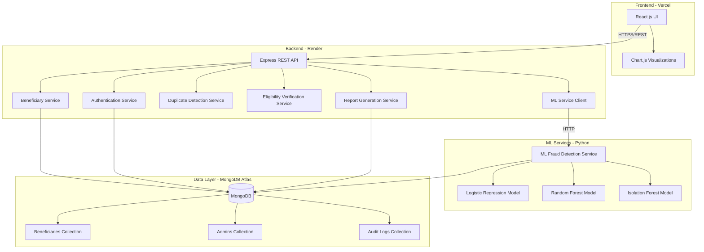
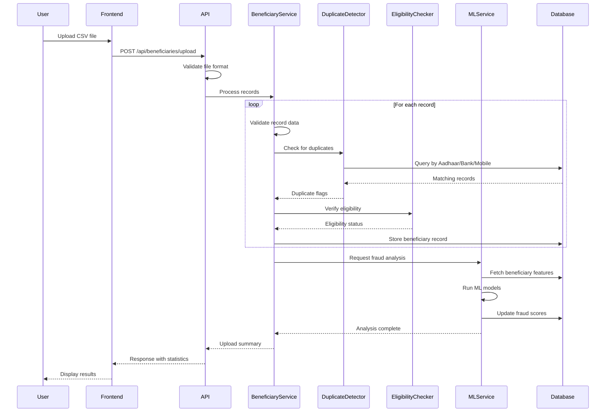

# Design Document: AI-Based Subsidy Leakage Detection and Monitoring System

## Overview

The AI-Based Subsidy Leakage Detection and Monitoring System is a full-stack web application designed to detect and prevent subsidy fraud through automated data validation, duplicate detection, eligibility verification, and machine learning-based anomaly detection.

The system follows a three-tier architecture:
- **Frontend Layer**: React.js single-page application with Chart.js for data visualization
- **Backend Layer**: Node.js + Express REST API handling business logic, data validation, and orchestration
- **Data Layer**: MongoDB for persistent storage and Python ML services for fraud detection

Key design principles:
- **Separation of Concerns**: Clear boundaries between presentation, business logic, and data layers
- **Security by Design**: Encryption, masking, and validation at every layer
- **Scalability**: Stateless API design supporting horizontal scaling
- **Testability**: Pure functions and dependency injection for comprehensive testing

## Architecture

### System Architecture Diagram



### Component Interaction Flow



## Components and Interfaces

### Frontend Components

#### 1. Authentication Module
- **LoginPage**: Handles admin credential input and authentication
- **AuthContext**: React context managing authentication state and session
- **ProtectedRoute**: Higher-order component enforcing authentication

#### 2. Dashboard Module
- **DashboardPage**: Main analytics view displaying statistics and charts
- **StatisticsCards**: Component showing total beneficiaries, fraud count, leakage percentage
- **SchemeWiseChart**: Bar chart showing fraud distribution by scheme type
- **DistrictWiseChart**: Geographic visualization of fraud by district
- **TrendChart**: Line chart showing fraud trends over time

#### 3. Beneficiary Management Module
- **BeneficiaryListPage**: Table view of all beneficiaries with filtering and sorting
- **BeneficiaryDetailPage**: Detailed view of single beneficiary with fraud analysis
- **BeneficiaryFormPage**: Form for creating/editing beneficiary records
- **UploadPage**: CSV file upload interface with validation feedback

#### 4. Reports Module
- **ReportsPage**: Interface for generating and downloading reports
- **FilterPanel**: Component for selecting report criteria
- **ExportButtons**: Buttons triggering CSV/PDF generation

### Backend Services

#### 1. Authentication Service

```typescript
interface AuthService {
  // Authenticate admin with credentials
  authenticate(email: string, password: string): Promise<AuthToken>
  
  // Verify JWT token and return admin info
  verifyToken(token: string): Promise<Admin>
  
  // Check if admin has required role
  hasPermission(admin: Admin, requiredRole: Role): boolean
  
  // Hash password with salt
  hashPassword(password: string): Promise<string>
  
  // Verify password against hash
  verifyPassword(password: string, hash: string): Promise<boolean>
}

interface AuthToken {
  token: string
  expiresAt: Date
  admin: Admin
}

interface Admin {
  id: string
  email: string
  name: string
  role: Role
  createdAt: Date
}

enum Role {
  SUPER_ADMIN = "SUPER_ADMIN",
  ADMIN = "ADMIN",
  VIEWER = "VIEWER"
}
```

#### 2. Beneficiary Service

```typescript
interface BeneficiaryService {
  // Create new beneficiary record
  create(data: BeneficiaryInput): Promise<Beneficiary>
  
  // Get beneficiary by ID
  getById(id: string): Promise<Beneficiary | null>
  
  // Update beneficiary record
  update(id: string, data: Partial<BeneficiaryInput>): Promise<Beneficiary>
  
  // Delete beneficiary record
  delete(id: string): Promise<void>
  
  // List beneficiaries with filtering and pagination
  list(filters: BeneficiaryFilters, pagination: Pagination): Promise<BeneficiaryList>
  
  // Process CSV upload
  uploadCSV(file: Buffer): Promise<UploadResult>
  
  // Validate beneficiary data
  validate(data: BeneficiaryInput): ValidationResult
}

interface BeneficiaryInput {
  name: string
  aadhaarNumber: string
  age: number
  gender: "Male" | "Female" | "Other"
  address: string
  district: string
  income: number
  familySize: number
  schemeType: string
  bankAccount: string
  ifsc: string
  subsidyAmount: number
  claimFrequency: number
  registrationDate: Date
  lastClaimDate: Date
}

interface Beneficiary extends BeneficiaryInput {
  id: string
  eligibilityStatus: "Eligible" | "Ineligible"
  fraudScore: number
  riskClassification: "Low" | "Medium" | "High"
  isDuplicate: boolean
  duplicateMatches: DuplicateMatch[]
  createdAt: Date
  updatedAt: Date
}

interface DuplicateMatch {
  matchType: "Aadhaar" | "BankAccount" | "Mobile"
  matchedBeneficiaryId: string
}

interface UploadResult {
  totalRecords: number
  successfulImports: number
  failedRecords: FailedRecord[]
}

interface FailedRecord {
  rowNumber: number
  data: any
  errors: string[]
}
```

#### 3. Duplicate Detection Service

```typescript
interface DuplicateDetectionService {
  // Check for duplicate Aadhaar numbers
  checkAadhaarDuplicate(aadhaarNumber: string, excludeId?: string): Promise<Beneficiary[]>
  
  // Check for duplicate bank accounts
  checkBankAccountDuplicate(bankAccount: string, ifsc: string, excludeId?: string): Promise<Beneficiary[]>
  
  // Check for duplicate mobile numbers
  checkMobileDuplicate(mobile: string, excludeId?: string): Promise<Beneficiary[]>
  
  // Run all duplicate checks
  detectDuplicates(beneficiary: BeneficiaryInput, excludeId?: string): Promise<DuplicateResult>
  
  // Update fraud scores for duplicate records
  updateDuplicateFraudScores(beneficiaryIds: string[]): Promise<void>
}

interface DuplicateResult {
  hasDuplicates: boolean
  aadhaarMatches: Beneficiary[]
  bankAccountMatches: Beneficiary[]
  mobileMatches: Beneficiary[]
}
```

#### 4. Eligibility Verification Service

```typescript
interface EligibilityVerificationService {
  // Verify beneficiary eligibility
  verifyEligibility(beneficiary: Beneficiary): Promise<EligibilityResult>
  
  // Get income threshold for scheme
  getIncomeThreshold(schemeType: string): number
  
  // Check scheme-specific criteria
  checkSchemeCriteria(beneficiary: Beneficiary, schemeType: string): Promise<CriteriaCheck[]>
}

interface EligibilityResult {
  isEligible: boolean
  reasons: string[]
  incomeCheck: boolean
  criteriaChecks: CriteriaCheck[]
}

interface CriteriaCheck {
  criterion: string
  passed: boolean
  message: string
}
```

#### 5. ML Service Client

```typescript
interface MLServiceClient {
  // Request fraud analysis for beneficiary
  analyzeFraud(beneficiary: Beneficiary): Promise<FraudAnalysisResult>
  
  // Batch analyze multiple beneficiaries
  batchAnalyze(beneficiaries: Beneficiary[]): Promise<FraudAnalysisResult[]>
  
  // Get model performance metrics
  getModelMetrics(): Promise<ModelMetrics>
}

interface FraudAnalysisResult {
  beneficiaryId: string
  fraudScore: number
  riskClassification: "Low" | "Medium" | "High"
  modelPredictions: {
    logisticRegression: number
    randomForest: number
    isolationForest: number
  }
  featureImportance: Record<string, number>
}

interface ModelMetrics {
  accuracy: number
  precision: number
  recall: number
  f1Score: number
  lastTrainedAt: Date
}
```

#### 6. Report Generation Service

```typescript
interface ReportGenerationService {
  // Generate CSV report
  generateCSV(filters: ReportFilters): Promise<Buffer>
  
  // Generate PDF report
  generatePDF(filters: ReportFilters): Promise<Buffer>
  
  // Get report data
  getReportData(filters: ReportFilters): Promise<ReportData>
}

interface ReportFilters {
  riskClassification?: "Low" | "Medium" | "High"
  schemeType?: string
  district?: string
  startDate?: Date
  endDate?: Date
}

interface ReportData {
  summary: {
    totalBeneficiaries: number
    fraudulentCount: number
    leakagePercentage: number
    totalSubsidyAmount: number
    fraudulentSubsidyAmount: number
  }
  highRiskBeneficiaries: Beneficiary[]
  schemeWiseAnalysis: SchemeAnalysis[]
  districtWiseAnalysis: DistrictAnalysis[]
}

interface SchemeAnalysis {
  schemeType: string
  totalBeneficiaries: number
  fraudCount: number
  leakagePercentage: number
}

interface DistrictAnalysis {
  district: string
  totalBeneficiaries: number
  fraudCount: number
  leakagePercentage: number
}
```

#### 7. Dashboard Service

```typescript
interface DashboardService {
  // Get dashboard statistics
  getStatistics(): Promise<DashboardStatistics>
  
  // Get scheme-wise analysis
  getSchemeWiseAnalysis(): Promise<SchemeAnalysis[]>
  
  // Get district-wise analysis
  getDistrictWiseAnalysis(): Promise<DistrictAnalysis[]>
  
  // Get fraud trend data
  getFraudTrends(startDate: Date, endDate: Date): Promise<TrendData[]>
}

interface DashboardStatistics {
  totalBeneficiaries: number
  fraudulentCount: number
  leakagePercentage: number
  totalSubsidyAmount: number
  fraudulentSubsidyAmount: number
  duplicateCount: number
  ineligibleCount: number
}

interface TrendData {
  date: Date
  fraudCount: number
  totalCount: number
  leakagePercentage: number
}
```

### ML Service (Python)

```python
class MLFraudDetectionService:
    """
    Machine learning service for fraud detection using ensemble approach
    """
    
    def __init__(self):
        self.logistic_model = None
        self.random_forest_model = None
        self.isolation_forest_model = None
        self.scaler = None
        self.feature_columns = [
            'income', 'claim_frequency', 'subsidy_amount', 
            'age', 'family_size', 'days_since_registration',
            'days_since_last_claim', 'income_to_subsidy_ratio'
        ]
    
    def train_models(self, training_data: pd.DataFrame) -> None:
        """Train all ML models on labeled data"""
        pass
    
    def predict_fraud(self, beneficiary_data: dict) -> FraudPrediction:
        """
        Predict fraud probability for a single beneficiary
        Returns ensemble prediction from all three models
        """
        pass
    
    def batch_predict(self, beneficiaries: List[dict]) -> List[FraudPrediction]:
        """Predict fraud for multiple beneficiaries"""
        pass
    
    def extract_features(self, beneficiary: dict) -> np.ndarray:
        """Extract and engineer features for ML models"""
        pass
    
    def calculate_fraud_score(self, predictions: dict) -> float:
        """
        Calculate final fraud score (0-100) from model predictions
        Uses weighted average of three models
        """
        pass
    
    def get_feature_importance(self) -> dict:
        """Get feature importance from Random Forest model"""
        pass

class FraudPrediction:
    beneficiary_id: str
    fraud_probability: float
    fraud_score: float  # 0-100
    risk_classification: str  # Low, Medium, High
    model_predictions: dict
    feature_importance: dict
```

## Data Models

### MongoDB Collections

#### Beneficiaries Collection

```typescript
interface BeneficiaryDocument {
  _id: ObjectId
  beneficiaryId: string  // Unique identifier
  
  // Personal Information
  name: string
  aadhaarNumber: string  // Encrypted
  age: number
  gender: "Male" | "Female" | "Other"
  address: string
  district: string
  mobile?: string  // Optional
  
  // Financial Information
  income: number
  familySize: number
  bankAccount: string  // Encrypted
  ifsc: string
  
  // Subsidy Information
  schemeType: string
  subsidyAmount: number
  claimFrequency: number
  registrationDate: Date
  lastClaimDate: Date
  
  // Verification Status
  eligibilityStatus: "Eligible" | "Ineligible"
  eligibilityReasons: string[]
  
  // Fraud Detection
  fraudScore: number  // 0-100
  riskClassification: "Low" | "Medium" | "High"
  fraudLabel: boolean  // Ground truth for training
  
  // Duplicate Detection
  isDuplicate: boolean
  duplicateMatches: Array<{
    matchType: "Aadhaar" | "BankAccount" | "Mobile"
    matchedBeneficiaryId: string
    detectedAt: Date
  }>
  
  // ML Predictions
  mlPredictions: {
    logisticRegression: number
    randomForest: number
    isolationForest: number
    lastAnalyzedAt: Date
  }
  
  // Metadata
  createdAt: Date
  updatedAt: Date
  createdBy: string  // Admin ID
  updatedBy: string  // Admin ID
}
```

#### Admins Collection

```typescript
interface AdminDocument {
  _id: ObjectId
  email: string  // Unique
  passwordHash: string
  name: string
  role: "SUPER_ADMIN" | "ADMIN" | "VIEWER"
  isActive: boolean
  lastLoginAt: Date
  createdAt: Date
  updatedAt: Date
}
```

#### Audit Logs Collection

```typescript
interface AuditLogDocument {
  _id: ObjectId
  adminId: string
  action: string  // e.g., "CREATE_BENEFICIARY", "UPDATE_BENEFICIARY", "DELETE_BENEFICIARY"
  resourceType: string  // e.g., "Beneficiary", "Admin"
  resourceId: string
  changes: any  // Object containing before/after values
  ipAddress: string
  userAgent: string
  timestamp: Date
}
```

### Database Indexes

```typescript
// Beneficiaries Collection Indexes
{
  beneficiaryId: 1  // Unique index
  aadhaarNumber: 1  // For duplicate detection
  bankAccount: 1, ifsc: 1  // Compound index for duplicate detection
  mobile: 1  // For duplicate detection
  riskClassification: 1  // For filtering high-risk beneficiaries
  schemeType: 1  // For scheme-wise analysis
  district: 1  // For district-wise analysis
  fraudScore: -1  // For sorting by fraud score
  registrationDate: 1  // For trend analysis
}

// Admins Collection Indexes
{
  email: 1  // Unique index
}

// Audit Logs Collection Indexes
{
  adminId: 1, timestamp: -1  // For admin activity tracking
  resourceType: 1, resourceId: 1  // For resource history
  timestamp: -1  // For recent activity queries
}
```

## Data Flow

### 1. CSV Upload and Processing Flow

```
User uploads CSV → Frontend validates file → API receives file → 
Parse CSV rows → For each row:
  ├─ Validate data format
  ├─ Encrypt sensitive fields (Aadhaar, Bank Account)
  ├─ Check for duplicates
  ├─ Verify eligibility
  ├─ Store in database
  └─ Collect validation errors
→ Trigger ML batch analysis → Update fraud scores → 
Return upload summary to user
```

### 2. Fraud Detection Flow

```
Beneficiary record created/updated → 
Extract features (income, claim frequency, etc.) →
Send to ML Service →
ML Service runs three models:
  ├─ Logistic Regression (linear patterns)
  ├─ Random Forest (non-linear patterns)
  └─ Isolation Forest (anomaly detection)
→ Calculate weighted fraud score →
Assign risk classification →
Update beneficiary record →
Trigger alerts if high risk
```

### 3. Duplicate Detection Flow

```
New beneficiary data → 
Check Aadhaar in database →
Check Bank Account + IFSC in database →
Check Mobile in database →
If matches found:
  ├─ Flag all matching records as duplicates
  ├─ Increase fraud scores
  └─ Create duplicate match records
→ Return duplicate result
```

### 4. Dashboard Data Flow

```
User requests dashboard → 
API aggregates data:
  ├─ Count total beneficiaries
  ├─ Count high-risk beneficiaries
  ├─ Calculate leakage percentage
  ├─ Group by scheme type
  ├─ Group by district
  └─ Calculate trends over time
→ Return aggregated statistics →
Frontend renders charts
```


## Correctness Properties

*A property is a characteristic or behavior that should hold true across all valid executions of a system—essentially, a formal statement about what the system should do. Properties serve as the bridge between human-readable specifications and machine-verifiable correctness guarantees.*

### Authentication and Authorization Properties

**Property 1: Valid credentials create authenticated sessions**
*For any* valid admin credentials (email and password), authenticating with those credentials should create a session containing the correct admin information and a valid token.
**Validates: Requirements 1.1**

**Property 2: Invalid credentials are rejected**
*For any* invalid credential combination (wrong email, wrong password, or both), authentication should fail and return an appropriate error message without creating a session.
**Validates: Requirements 1.2**

**Property 3: Role-based access control**
*For any* authenticated admin and any feature requiring specific permissions, access should be granted if and only if the admin's role has the required permissions.
**Validates: Requirements 1.3**

**Property 4: Expired sessions require re-authentication**
*For any* expired session token, attempting to access protected resources should fail with an authentication error requiring re-login.
**Validates: Requirements 1.4**

**Property 5: Credentials are hashed, not stored in plaintext**
*For any* admin password stored in the database, the stored value should be a cryptographic hash, not the plaintext password.
**Validates: Requirements 1.5**

### Beneficiary Data Management Properties

**Property 6: Valid beneficiary creation with unique IDs**
*For any* valid beneficiary data, creating a beneficiary record should store the data in the database and assign a unique Beneficiary_ID that differs from all existing IDs.
**Validates: Requirements 2.1**

**Property 7: Invalid beneficiary data is rejected**
*For any* beneficiary data that violates validation rules (missing required fields, invalid data types, constraint violations), the creation should fail and return specific validation errors.
**Validates: Requirements 2.2, 2.6**

**Property 8: Beneficiary retrieval round-trip with Aadhaar masking**
*For any* beneficiary record created in the system, retrieving it by Beneficiary_ID should return the same data with Aadhaar_Number masked (showing only last 4 digits).
**Validates: Requirements 2.3**

**Property 9: Updates persist and update timestamps**
*For any* valid beneficiary update, the changes should be persisted in the database and the updatedAt timestamp should be more recent than the previous value.
**Validates: Requirements 2.4**

**Property 10: Deletion removes from active data but preserves audit trail**
*For any* beneficiary record, after deletion, the record should not appear in active queries but should exist in the audit logs with deletion details.
**Validates: Requirements 2.5**

### CSV Upload and Processing Properties

**Property 11: Valid CSV files are fully processed**
*For any* valid CSV file containing beneficiary records, uploading should parse all rows and store all valid records in the database.
**Validates: Requirements 3.1, 3.5**

**Property 12: Invalid CSV format is rejected**
*For any* CSV file with invalid format (wrong delimiter, missing columns, incorrect headers), the upload should be rejected with descriptive format errors.
**Validates: Requirements 3.2**

**Property 13: CSV validation reports specific row failures**
*For any* CSV file containing some invalid records, the validation should report the exact row numbers and specific validation errors for each failed record.
**Validates: Requirements 3.3**

**Property 14: Upload summary accuracy**
*For any* CSV upload, the returned summary counts (total records, successful imports, failed records) should exactly match the actual processing results.
**Validates: Requirements 3.4**

### Duplicate Detection Properties

**Property 15: Duplicate detection across all identifier types**
*For any* new beneficiary record, if there exists another record with matching Aadhaar_Number, or matching Bank_Account+IFSC combination, or matching mobile number, the system should detect and flag the duplicate.
**Validates: Requirements 4.1, 4.2, 4.3**

**Property 16: All duplicate records are flagged**
*For any* set of beneficiary records sharing an identifier, when a duplicate is detected, all records in the duplicate group should be flagged with isDuplicate=true.
**Validates: Requirements 4.4**

**Property 17: Duplicates increase fraud scores**
*For any* beneficiary records flagged as duplicates, their fraud scores should be higher than they would be without the duplicate flag.
**Validates: Requirements 4.5**

**Property 18: Duplicate match tracking**
*For any* duplicate detection, the system should maintain a record of which beneficiaries match, what type of match occurred (Aadhaar/BankAccount/Mobile), and when it was detected.
**Validates: Requirements 4.6**

### Eligibility Verification Properties

**Property 19: Income threshold comparison**
*For any* beneficiary and scheme type, the eligibility check should correctly compare the beneficiary's income against the scheme-specific threshold.
**Validates: Requirements 5.1**

**Property 20: Income exceeding threshold marks ineligible**
*For any* beneficiary whose income exceeds the scheme's income threshold, the eligibility status should be set to "Ineligible".
**Validates: Requirements 5.2**

**Property 21: All eligibility criteria are evaluated**
*For any* beneficiary and scheme type, the eligibility verification should check all scheme-specific criteria, not just income.
**Validates: Requirements 5.3**

**Property 22: Ineligibility reasons are documented**
*For any* beneficiary marked as ineligible, the system should store specific reasons explaining which criteria were not met.
**Validates: Requirements 5.4**

**Property 23: Configurable scheme thresholds**
*For any* two different scheme types, the system should support different income thresholds for each scheme.
**Validates: Requirements 5.5**

### ML-Based Fraud Detection Properties

**Property 24: All ML models generate predictions**
*For any* beneficiary record analyzed for fraud, all three ML models (Logistic Regression, Random Forest, Isolation Forest) should generate predictions.
**Validates: Requirements 6.1**

**Property 25: Fraud scores are in valid range**
*For any* beneficiary analyzed by the ML service, the assigned fraud score should be in the range [0, 100].
**Validates: Requirements 6.2**

**Property 26: Risk classification matches fraud score thresholds**
*For any* beneficiary with a fraud score, the risk classification should be "High" if score > 70, "Medium" if 40 ≤ score ≤ 70, and "Low" if score < 40.
**Validates: Requirements 6.3, 6.5, 6.6, 6.7**

**Property 27: Required features are extracted**
*For any* beneficiary record, the ML feature extraction should include Income, Claim_Frequency, Subsidy_Amount, Age, Family_Size, and time-based features (days since registration, days since last claim).
**Validates: Requirements 6.4**

### Analytics Dashboard Properties

**Property 28: Dashboard metrics match database state**
*For any* dashboard request, the displayed statistics (total beneficiaries, fraud count, leakage percentage) should exactly match the current database state when computed.
**Validates: Requirements 7.1, 7.2, 7.7**

**Property 29: Leakage percentage calculation accuracy**
*For any* set of beneficiary records, the leakage percentage should equal (sum of subsidy amounts for High-risk beneficiaries / sum of all subsidy amounts) × 100.
**Validates: Requirements 7.3**

**Property 30: Scheme-wise aggregation accuracy**
*For any* scheme type, the scheme-wise analysis should show counts that match the actual number of beneficiaries and fraudulent records for that scheme in the database.
**Validates: Requirements 7.4**

**Property 31: District-wise aggregation accuracy**
*For any* district, the district-wise analysis should show counts that match the actual number of beneficiaries and fraudulent records for that district in the database.
**Validates: Requirements 7.5**

**Property 32: Fraud trend accuracy over time**
*For any* time period, the fraud trend data should accurately reflect the number of fraudulent records registered or claiming subsidies in each time bucket.
**Validates: Requirements 7.6**

### Report Generation Properties

**Property 33: CSV export completeness**
*For any* CSV export request, the generated file should contain all beneficiary records (or filtered subset) with complete fraud detection results including fraud scores and risk classifications.
**Validates: Requirements 8.1**

**Property 34: PDF report contains required sections**
*For any* PDF report request, the generated document should contain summary statistics and a list of high-risk beneficiaries.
**Validates: Requirements 8.2**

**Property 35: Report content includes required fields with masked Aadhaar**
*For any* generated report (CSV or PDF), each beneficiary entry should include Beneficiary_ID, Name, Fraud_Score, Risk_Classification, duplicate flags, and Aadhaar_Number should be masked (only last 4 digits visible).
**Validates: Requirements 8.3, 8.4**

**Property 36: Report filtering accuracy**
*For any* report generated with filters (Risk_Classification, Scheme_Type, District), the report should contain only records matching all specified filter criteria.
**Validates: Requirements 8.5**

### Data Security and Privacy Properties

**Property 37: Sensitive fields are encrypted at rest**
*For any* beneficiary record stored in the database, the Aadhaar_Number and Bank_Account fields should be encrypted, not stored in plaintext.
**Validates: Requirements 9.1, 9.4**

**Property 38: Aadhaar masking in all interfaces**
*For any* Aadhaar_Number displayed in the user interface or returned by the API, only the last 4 digits should be visible, with the rest masked.
**Validates: Requirements 9.2**

**Property 39: Password hashing with salt**
*For any* admin password stored in the system, the stored value should be a salted cryptographic hash, not the plaintext password.
**Validates: Requirements 9.5**

**Property 40: Input sanitization prevents injection**
*For any* user input containing potentially malicious content (SQL injection, XSS, command injection patterns), the system should sanitize or reject the input before processing.
**Validates: Requirements 9.6**

## Error Handling

### Authentication Errors

- **Invalid Credentials**: Return 401 Unauthorized with message "Invalid email or password"
- **Expired Token**: Return 401 Unauthorized with message "Session expired, please login again"
- **Insufficient Permissions**: Return 403 Forbidden with message "You do not have permission to access this resource"
- **Missing Token**: Return 401 Unauthorized with message "Authentication required"

### Validation Errors

- **Missing Required Fields**: Return 400 Bad Request with list of missing fields
- **Invalid Data Types**: Return 400 Bad Request with field name and expected type
- **Constraint Violations**: Return 400 Bad Request with specific constraint that was violated
- **Duplicate Identifier**: Return 409 Conflict with message indicating which identifier is duplicated

### CSV Upload Errors

- **Invalid File Format**: Return 400 Bad Request with message "Invalid CSV format: [specific error]"
- **Missing Required Columns**: Return 400 Bad Request with list of missing columns
- **Row Validation Failures**: Return 207 Multi-Status with summary and array of failed rows with errors
- **File Too Large**: Return 413 Payload Too Large with maximum file size

### ML Service Errors

- **Model Not Available**: Return 503 Service Unavailable with message "ML service temporarily unavailable"
- **Feature Extraction Failed**: Return 500 Internal Server Error with message "Failed to extract features for fraud analysis"
- **Prediction Failed**: Return 500 Internal Server Error with message "Fraud prediction failed"

### Database Errors

- **Connection Failed**: Return 503 Service Unavailable with message "Database connection failed"
- **Query Timeout**: Return 504 Gateway Timeout with message "Database query timed out"
- **Duplicate Key**: Return 409 Conflict with message "Record with this identifier already exists"
- **Document Not Found**: Return 404 Not Found with message "Beneficiary not found"

### General Error Handling Strategy

1. **Validation Errors**: Fail fast at the API boundary, return detailed validation errors
2. **Business Logic Errors**: Return appropriate HTTP status codes with clear messages
3. **System Errors**: Log detailed error information, return generic message to client
4. **Async Errors**: Use try-catch blocks with proper error propagation
5. **Error Logging**: Log all errors with context (user ID, request ID, timestamp, stack trace)

## Testing Strategy

### Dual Testing Approach

This system requires both unit testing and property-based testing for comprehensive coverage:

- **Unit Tests**: Verify specific examples, edge cases, and error conditions
- **Property Tests**: Verify universal properties across all inputs using randomized test data

Both testing approaches are complementary and necessary. Unit tests catch concrete bugs in specific scenarios, while property tests verify general correctness across a wide range of inputs.

### Property-Based Testing Configuration

**Framework Selection**:
- **Backend (Node.js/TypeScript)**: Use `fast-check` library for property-based testing
- **ML Service (Python)**: Use `hypothesis` library for property-based testing

**Test Configuration**:
- Each property test MUST run minimum 100 iterations to ensure adequate coverage
- Each property test MUST include a comment tag referencing the design document property
- Tag format: `// Feature: subsidy-fraud-detection, Property {number}: {property_text}`

**Property Test Implementation**:
- Each correctness property listed above MUST be implemented as a SINGLE property-based test
- Use generators to create random valid and invalid test data
- Verify the property holds for all generated inputs

### Unit Testing Strategy

**Focus Areas for Unit Tests**:
1. **Specific Examples**: Test concrete scenarios that demonstrate correct behavior
2. **Edge Cases**: Test boundary conditions (empty strings, zero values, maximum values)
3. **Error Conditions**: Test specific error scenarios and error message content
4. **Integration Points**: Test interactions between components

**Unit Test Balance**:
- Avoid writing too many unit tests for scenarios covered by property tests
- Focus unit tests on specific examples that illustrate important behaviors
- Use unit tests for integration testing between services

### Test Coverage by Component

#### Authentication Service Tests
- **Property Tests**: Properties 1-5 (valid/invalid credentials, role-based access, session expiry, password hashing)
- **Unit Tests**: Specific role permission combinations, token expiration edge cases

#### Beneficiary Service Tests
- **Property Tests**: Properties 6-10 (CRUD operations, validation, round-trip)
- **Unit Tests**: Specific validation rules, edge cases for each field type

#### CSV Upload Tests
- **Property Tests**: Properties 11-14 (CSV parsing, validation, summary accuracy)
- **Unit Tests**: Specific CSV format errors, empty files, large files

#### Duplicate Detection Tests
- **Property Tests**: Properties 15-18 (duplicate detection, flagging, fraud score adjustment)
- **Unit Tests**: Specific duplicate scenarios (exact matches, partial matches)

#### Eligibility Verification Tests
- **Property Tests**: Properties 19-23 (income comparison, criteria evaluation, threshold configuration)
- **Unit Tests**: Specific scheme criteria, edge cases at threshold boundaries

#### ML Service Tests
- **Property Tests**: Properties 24-27 (model predictions, score ranges, feature extraction)
- **Unit Tests**: Specific fraud patterns, model performance on known examples

#### Dashboard Service Tests
- **Property Tests**: Properties 28-32 (metric accuracy, aggregations, trends)
- **Unit Tests**: Specific aggregation scenarios, empty database state

#### Report Generation Tests
- **Property Tests**: Properties 33-36 (export completeness, filtering, content)
- **Unit Tests**: Specific report formats, empty result sets

#### Security Tests
- **Property Tests**: Properties 37-40 (encryption, masking, hashing, sanitization)
- **Unit Tests**: Specific injection attack patterns, encryption algorithm verification

### Integration Testing

**API Integration Tests**:
- Test complete request/response cycles through the REST API
- Verify authentication middleware integration
- Test error handling across the API boundary

**Database Integration Tests**:
- Test MongoDB queries and aggregations with real database
- Verify index usage and query performance
- Test transaction handling for multi-document operations

**ML Service Integration Tests**:
- Test communication between Node.js backend and Python ML service
- Verify data serialization/deserialization
- Test error handling when ML service is unavailable

### Test Data Generation

**Generators for Property Tests**:
- **Valid Beneficiary Generator**: Creates random valid beneficiary records
- **Invalid Beneficiary Generator**: Creates records with various validation violations
- **Duplicate Generator**: Creates sets of records with intentional duplicates
- **CSV Generator**: Creates valid and invalid CSV files
- **Admin Generator**: Creates admin records with various roles

**Test Data Constraints**:
- Aadhaar numbers: 12-digit strings
- Bank accounts: 9-16 digit strings
- IFSC codes: 11-character alphanumeric strings
- Income: Positive numbers with realistic ranges
- Ages: 18-100 years
- Fraud scores: 0-100

### Continuous Testing

**Pre-commit Hooks**:
- Run unit tests before allowing commits
- Run linting and type checking

**CI/CD Pipeline**:
- Run all unit tests on every pull request
- Run property tests (with reduced iterations for speed) on pull requests
- Run full property test suite (100+ iterations) on main branch
- Generate code coverage reports
- Fail build if coverage drops below threshold (80%)

### Performance Testing

While not part of property-based testing, the following performance tests should be conducted:

- **Load Testing**: Test API endpoints with concurrent requests
- **Stress Testing**: Test system behavior under extreme load
- **ML Service Performance**: Measure prediction latency for single and batch requests
- **Database Query Performance**: Measure query execution times for large datasets

### Test Documentation

Each test file should include:
- Clear description of what is being tested
- References to requirements and design properties
- Examples of test data being used
- Expected outcomes and assertions
